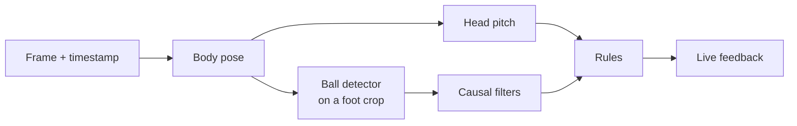

# Gaffer's Vision

Objective soccer drill feedback from a single phone camera, in real time.

Solo training is full of repetition but short on feedback. Coaches can't be at every session, sensors and wearables are expensive, and most drill apps give a score without showing how you played. Gaffer's Vision watches one drill, the **tick-tock**, through an ordinary camera and reports:

- **Tick-tocks** by foot, and every other **contact** with the ball
- **Pace** in tick-tocks per minute (players work toward 150)
- **Head-down time**
- **Lost-control** moments

In a tick-tock, the player knocks the ball side to side between the insides of their feet, ideally with their head up. A tick-tock counts when one foot sends the ball across the midpoint and the other foot makes the next touch.

## How it works



| Stage | Method |
|---|---|
| Body pose | MediaPipe Pose Landmarker (lite) |
| Ball | YOLOv8n on a square foot crop, with a full-frame search after repeated misses |
| Head pitch | MediaPipe Face Landmarker on a head crop |
| Smoothing | One Euro filter for keypoints, Kalman filter for the ball |
| Metrics | Rules with thresholds in `src/config.py` |

The pipeline never reads future frames, and recorded clips and live video run through the same per-frame `step()`. Video is processed on the device; the only network use is downloading model files on first run.

## Results

Tick-tocks on 7 hand-labelled clips, where a detection counts if it is within ±0.2 s of a label:

| Measure | Result |
|---|---|
| Precision | **96.5%** (360 of 373 detected) |
| Recall | **92.8%** (360 of 388 labelled) |
| Correct foot | **100%** of matched tick-tocks |
| Median timing error | **33 ms** |

These are development clips recorded by the team, so expect different results on new players and settings.

## Getting started

You need **Python 3.12** and **FFmpeg** (`ffprobe` must be on your PATH).

```bash
git clone https://github.com/siddcv/ForgeGaffersVision.git
cd ForgeGaffersVision
git checkout develop                                # latest work

python3.12 -m venv ~/.venvs/gaffers-vision          # Windows: py -3.12 -m venv ~/.venvs/gaffers-vision
source ~/.venvs/gaffers-vision/bin/activate         # Windows (Git Bash): source ~/.venvs/gaffers-vision/Scripts/activate
pip install -r requirements.txt
```

### Run live

```bash
python -m src.live                                  # camera 0
python -m src.live --source 1                       # another camera, such as a phone used as a webcam
python -m src.live --rotate 90 --flip               # sideways feed / undo a mirrored feed
```

Stand so your whole body and the ball are in frame, then press **START** (or space). Press it again to stop and see your drill report. Press `q` to quit. Each drill is saved locally: the recording in `data/clips/live/`, the results and overlay video in `output/live/`.

### Analyze a recorded clip

```bash
python -m src.run_clip path/to/clip.mp4             # report and overlay video in output/
python -m src.label_clip path/to/clip.mp4           # hand-label events by key press
python -m src.evaluate output/<clip>_stride1/report.json   # score against the labels
```

### Run the tests

```bash
python -m pytest
```

## iPhone app

A native prototype, built with Swift and Core ML, runs the pipeline on the phone at about 30 fps. It is on the [`swift-core`](https://github.com/siddcv/ForgeGaffersVision/tree/swift-core) branch; see its [build instructions](https://github.com/siddcv/ForgeGaffersVision/blob/swift-core/ios/README.md).

## Repository layout

| Path | Contents |
|---|---|
| `src/` | Pipeline, metrics, live app, labelling and evaluation tools |
| `scripts/` | Core ML export, detector benchmark, test-vector export |
| `tests/` | Unit tests, and the shared test vectors for the Swift port |
| `data/` | Clip manifest and hand labels ([format](data/README.md)); videos are not in git |
| `docs/` | Notes on [preprocessing](docs/PREPROCESSING.md), [fine-tuning](docs/FINE_TUNING.md) and the [iOS port](docs/IOS_PORT_PLAN.md) |

## Status and limitations

- The tick-tock is the only supported drill.
- Tick-tocks are confirmed about 0.44 s after the touch, because the other foot has to answer. The target is 200–300 ms.
- Head-down and lost-control detection have been checked on very few clips. Lost-control timing is still loose.
- The ball detector is not yet fine-tuned on our footage.

## Team

Aarav Jalan, Arhan Sheth, Pravalika Arunkumar, Rayaa Williams, Siddharth Venkatesh

**Clients:** Marcelo Worsley and Herminio Bodon

Thank you to Professor Anastasia Kurdia for guidance. Built at The Forge, Northwestern University.
